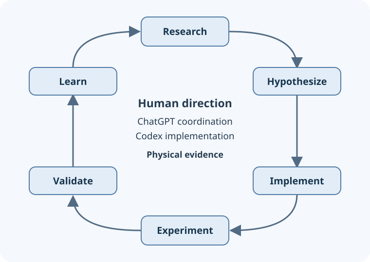

# Evidence-driven agentic reverse engineering

## Purpose
PL-STOCK-001 demonstrates collaborative human and AI-assisted engineering on owner-controlled physical hardware. The achievement is the reproducible process, not a claim that AI replaces hardware engineering or that a worldwide first has been established.

## Roles
| Participant | Responsibility |
|---|---|
| Human owner | Define goals and constraints, supply physical context, verify labels, authorize operations, decide when performance is sufficient and when to preserve a reference unit. |
| ChatGPT | Coordinate research, separate hypotheses from measurements, design bounded experiments, inspect results, review code and synthesize findings. |
| Codex | Implement scoped components, examine static references, develop parsers and offline models, and help produce tests. |
| Physical hardware | Supply the authoritative observations for the tested firmware and board. |

The human guided the conversation while ChatGPT coordinated Codex within the existing rootless lab. The agents worked in iterative cycles, not as independent authorities. Codex sometimes timed out or generated incorrect framing; ChatGPT reviewed and corrected these findings. Neither a successful tool exit nor an AI-generated explanation substitutes for physical evidence.

## Six-stage loop
1. **Research:** inspect attributed public references, community memory maps, historical executable symbols and earlier captures. Keep reference material distinct from original implementation.
2. **Hypothesize:** formulate a specific falsifiable explanation. For example, distinguish absent network connectivity from incorrect packet framing.
3. **Implement:** write the smallest bounded test or software component; restrict the target, operation, output and timeout. Prefer standard-library code and injected mock transports.
4. **Experiment:** exercise a narrow authorized hypothesis, capture results and preserve the prior state. Read-only experiments do not imply permission to program flash.
5. **Validate:** compare independent evidence, test malformed inputs, correlate transactions and verify hashes. Stop on ambiguity or identity mismatch.
6. **Learn:** retain both positive and negative results, correct the model, update documentation and only then expand scope. Repeat.

## Examples from the milestone
| Initial hypothesis or constraint | Experimental evidence | Resulting learning |
|---|---|---|
| Passive discovery would suffice | No candidate appeared | Active discovery needed investigation |
| No ping implied unreachable device | UDP identity transaction succeeded | ICMP was not a reliable availability signal |
| Initial serial decoding was correct | Physical label disagreed | Correct word-level byte ordering |
| Transport acknowledgement meant successful read | No matching data payload | Separate transport and application evidence |
| Word-by-word access was adequate | 2 KiB/s measured | Optimize after baseline correctness |
| Batching might preserve ordered retrieval | Independent comparison passed | Use bounded batches and cumulative acknowledgements |
| Data reads might auto-increment | Repeated selected word | Reject assumption for tested mode |
| Full acquisition would finish uninterrupted | One timeout | Preserve checkpoints, reverify idle and resume |

See [experiment history](EXPERIMENT_HISTORY.md) and [performance](PERFORMANCE.md) for actual measurements.

## Evidence and safety boundaries
Record PHYSICAL, STATIC, REFERENCE, SIMULATED and UNVERIFIED findings separately. Preserve raw data and unique identifiers privately. Keep original code and unsuccessful experiments in a private evidence archive. Do not publish proprietary firmware, captured identity values, credentials or historical binaries. Independent code authorship does not establish formal clean-room status or legal clearance.

## Why the workflow accelerated
Each confirmed finding narrowed the hypothesis space for the next experiment. The human provided direction and hardware ground truth; ChatGPT coordinated and reviewed; Codex helped reduce implementation effort. The final acquisition used one sequential binary and measured batching improvements. The process was iterative, not a single prompt or a fully autonomous uncontrolled scan. Exact human/agent labor savings were not measured. Future experiments should retain this pattern, including explicit approval gates for changes to device state.
