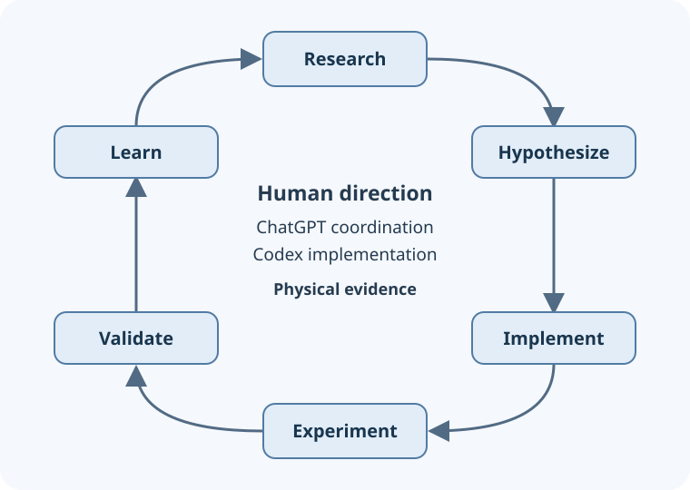

# Stock Pano G2 research — PL-STOCK-001

November 24, 2026 (Pacific). One physical stock G2 Rev B tested. This is an experimental source suite, not a production updater or a restoration qualification.

The laboratory acquired the entire documented 16 MiB stock SPI extent over Ethernet without JTAG, enclosure opening, executing the old updater, or issuing flash program/erase commands. 512 blocks, 47 prior-reference comparisons, 366.732 seconds of successful read operations. One timeout was recovered at a verified checkpoint. Full second pass and direct JEDEC identification remain outstanding.

## Navigation
- [Protocol](PROTOCOL.md) — observed transport behavior and bounds.
- [Register map](REGISTER_MAP.md) — measured configuration words.
- [Flash layout](FLASH_LAYOUT.md) — physical observation versus published geometry.
- [Experiment history](#experiment-history) — staged discoveries and failed assumptions.
- [Performance](PERFORMANCE.md) — actual benchmark results.
- [Sources and licensing](SOURCES.md) — provenance and publication boundary.
- [Agentic workflow](#evidence-driven-workflow) — human, ChatGPT and Codex roles, experiment cycle and lessons.
- [Tools and testing](#tools-and-offline-tests) — source entry points, qualification and private outputs.

## Operating policy
Reference unit: retain stock firmware and investigate only nonpersistent behavior. Experimental units: identify and preserve their own backups independently; require a separate recovery plan and explicit authorization before any programming. No cross-device factory data substitution. Use an isolated owner-controlled lab, no Internet exposure, no concurrent controller. Neither device identity nor TNP is cryptographic authentication.

Only newly authored Python and sanitized research are included. Raw ROM, captured frames with actual device identifiers, private logs, historical executable/disassembly and unique hashes remain outside Git. The generalized candidate has offline tests; the original device-specific implementation was physically tested. Do not equate the two qualification levels.

## Evidence-driven workflow



### Roles

| Participant | Responsibility |
|---|---|
| Human owner | Define goals and constraints, supply physical context, verify labels, authorize operations, decide when performance is sufficient and when to preserve a reference unit. |
| ChatGPT | Coordinate research, separate hypotheses from measurements, design bounded experiments, inspect results, review code and synthesize findings. |
| Codex | Implement scoped components, examine static references, develop parsers and offline models, and help produce tests. |
| Physical hardware | Supply the authoritative observations for the tested firmware and board. |

The human guided the conversation while ChatGPT coordinated Codex within the existing rootless lab. The agents worked in iterative cycles, not as independent authorities. Codex sometimes timed out or generated incorrect framing; ChatGPT reviewed and corrected these findings. Neither a successful tool exit nor an AI-generated explanation substitutes for physical evidence.

### Six-stage loop
1. **Research:** inspect attributed public references, community memory maps, historical executable symbols and earlier captures. Keep reference material distinct from original implementation.
2. **Hypothesize:** formulate a specific falsifiable explanation. For example, distinguish absent network connectivity from incorrect packet framing.
3. **Implement:** write the smallest bounded test or software component; restrict the target, operation, output and timeout. Prefer standard-library code and injected mock transports.
4. **Experiment:** exercise a narrow authorized hypothesis, capture results and preserve the prior state. Read-only experiments do not imply permission to program flash.
5. **Validate:** compare independent evidence, test malformed inputs, correlate transactions and verify hashes. Stop on ambiguity or identity mismatch.
6. **Learn:** retain both positive and negative results, correct the model, update documentation and only then expand scope. Repeat.

Record physical, static, reference, simulated and unverified findings separately.
The original trial required independent correction of framing and tests and
encountered Codex timeouts. Labor savings were not measured. Follow the
[provenance and publication boundaries](SOURCES.md).
[Original workflow record](https://github.com/sirchuckalot/panolab-direct/blob/2ab466ce9977dd8880eba4fbb5ce2906caa0b7c6/research/pano-stock/AGENTIC_WORKFLOW.md)

## Experiment history

1. Passive UDP listener returned no announcements. Host neighbor discovery and physical label established initial target. ICMP failed; lack of ping did not establish unreachable hardware.
2. Initial Python wrong destination port and ephemeral source port timed out. Correct fixed source 8320 and destination 8321 yielded actual board ID. Direct container unicast worked.
3. Read eight identity words; initial serial interpretation incorrect. Per-word byte reversal reconciled against photograph. Directed discovery found stock board in about 14.74 seconds on explicitly authorized /24; no known individual IP needed. Broadcast failed.
4. Four network words retrieved. Connectionless CSR request returned acknowledgement only, not data. Reliable stream with zero initial sequence worked, status read returned zero, own-session disconnect returned peer to zero.
5. Small boot/golden reads repeated, known Xilinx synchronization word observed. Factory prefix matched all seven known identity words. Two full factory-sector passes over 16 sessions matched.
6. Conservative reader measured about 2 KiB/s. Batching ordered read pairs and cumulative acknowledgements improved throughput. Automatic increment hypothesis rejected by repeated selected-word reads. Two independent contiguous 512 KiB acquisitions matched.
7. Sequential single-file full extent acquired freshly in order. At block 220 one batch returned no data; stopped without appending it, verified all checkpoint hashes and idle identity, resumed. No gaps, synthetic FF or substituted earlier samples. 512 block hashes and 47 prior-reference comparisons passed. Golden/main equal; upper 7 MiB erased.
8. Reference unit retained as stock. Future separate experimental unit must have its own identification, backup and recovery qualification before modifications.

[Original experiment record](https://github.com/sirchuckalot/panolab-direct/blob/2ab466ce9977dd8880eba4fbb5ce2906caa0b7c6/research/pano-stock/EXPERIMENT_HISTORY.md) · [Benchmarks](PERFORMANCE.md)

## Tools and offline tests

Python standard library, Linux container. Run from this research directory:
```sh
PYTHONDONTWRITEBYTECODE=1 PYTHONPATH=tools python3 -m unittest discover -s tests -v
```

- inventory.py and lan_discover.py: authorized private subnet inventory/discovery; results contain private identities, stdout only. pano_discovery.py: identity decoder and collector.
- config_read.py, framing.py, stream_status.py: bounded configuration and stream primitives.
- batch_reader.py and sequential_image.py: ordered acquisition algorithm used in original experiment, adapted to explicit private device selection and a single binary with checkpoint. No programming mode. The generalized source is not physically qualified yet.
- perf_model.py: strict response parser and illustrative throughput model.
- flash_audit.py: offline comparison of two complete raw images, region and sector summaries. No device access.

Keep inventory and binary output outside the checkout, owner-only. Do not run concurrent clients. Select the target by verified physical identity; do not rely on IP alone. Candidate requires explicit private identity record, authorized subnet and owner backup confirmation. On interrupted transfer preserve existing checkpoint, confirm identity and idle status before resuming. No automatic retry or reset. The original reference acquisition and its source are separately preserved privately. Original physical qualification does not establish performance or correctness on other boards, or on generalized code. Do not perform restoration without separately qualified recovery.

Tests use synthetic identities and mock transport, never the actual board; real captures remain private.

[Original tools guide](https://github.com/sirchuckalot/panolab-direct/blob/2ab466ce9977dd8880eba4fbb5ce2906caa0b7c6/research/pano-stock/TOOLS.md)
